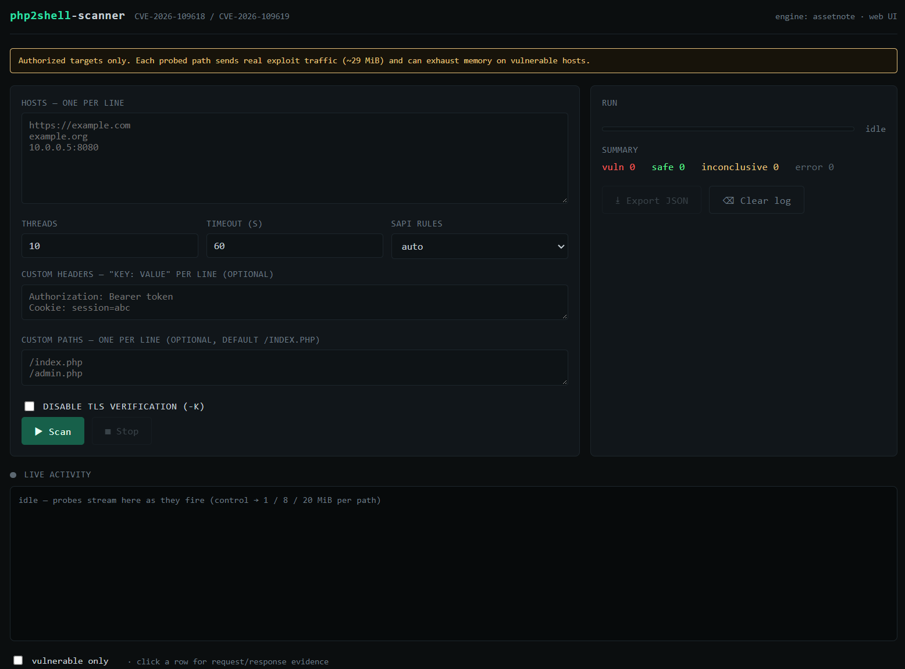

# php2shell-scanner — web UI

CVE-2026-109618 / CVE-2026-109619 tarayıcısının ([assetnote/php2shell-scanner](https://github.com/assetnote/php2shell-scanner)) tarayıcı tabanlı arayüzü.

> **Atıf.** Tespit motorunu (`scanner.py`) **assetnote yazdı** — biz yazmadık. Bu depo o motorun üzerine yalnızca bir **web arayüzü** ekler. `scanner.py` **birebir orijinal**, değiştirilmeden vendor edildi. Motora dair tüm hak ve emek assetnote'a aittir; orijinal için [assetnote/php2shell-scanner](https://github.com/assetnote/php2shell-scanner).

Backend sadece `scanner.check_vulnerability()`'yi bir thread havuzunda çağırıp sonuçları SSE ile canlı akıtıyor — CLI'daki `main()` mantığının aynısı. Tarama tarayıcıda değil, backend'de yapılıyor (CORS / forbidden-header / bağlantı-seviyesi crash tespiti sorunları bu yüzden yok).



> ⚠️ **Yalnızca yetkili hedeflerde kullanın.** Her denenen path gerçek exploit trafiği (~29 MiB) gönderir ve zafiyetli sunucuda bellek tüketimine yol açabilir.

## Dosyalar

| Dosya | Açıklama | Kim yazdı |
|---|---|---|
| `scanner.py` | Tespit motoru — **değiştirilmedi** | **assetnote** |
| `app.py` | FastAPI backend — UI servisi + `/api/scan` SSE endpoint | bu depo |
| `index.html` | Tek dosya terminal-tarzı dashboard (harici bağımlılık yok) | bu depo |
| `paths.txt` | Varsayılan tarama path listesi | bu depo |
| `requirements.txt` | Bağımlılıklar | — |

## Kurulum & çalıştırma

```bash
pip install -r requirements.txt
python app.py                      # -> http://127.0.0.1:8000
python app.py --host 0.0.0.0 --port 8000
```

Tarayıcıda `http://127.0.0.1:8000` aç. Host'ları (satır başına bir tane), thread/timeout/SAPI, opsiyonel header ve path'leri gir, **Scan**. Sonuçlar canlı dolar; satıra tıkla → request/response delili. **Export JSON** ile indir.

## Arayüz ↔ CLI eşlemesi

| CLI | UI |
|---|---|
| `-u` / `-l` | Hosts textarea (satır başına bir host) |
| `-t` | Threads (1–50) |
| `--timeout` | Timeout (s) |
| `--sapi` | SAPI dropdown (auto / mod_php / fpm) |
| `-H` | Custom headers (satır başına `Key: Value`) |
| `--path` / `--path-file` | Custom paths |
| `-k` | Disable TLS verification checkbox |
| `-o` | Export JSON butonu |

## Notlar

- `scanner.py` modül olarak import ediliyor, `main()` çalışmıyor; `import` güvenli.
- Thread üst sınırı 50 (her thread kendi asyncio döngüsünü kurar — CLI ile aynı davranış).
- Sunucu lokal/intranet içindir; internete açarsan önüne auth koy.

## Atıf / Credits

- **php2shell'i ilk keşfeden: Calif ekibi.** Orijinal keşif ve yazısı: <https://calif.io/php2shell/>
- **Tespit motoru (`scanner.py`): assetnote** — <https://github.com/assetnote/php2shell-scanner> (değiştirilmeden vendor edildi).
- **Web arayüzü (`app.py`, `index.html`, `paths.txt`): bu depo.**

## Lisans

Bu deponun **arayüz kodu** (`app.py`, `index.html`, `paths.txt`) MIT altındadır — bkz. [LICENSE](LICENSE).
`scanner.py` bu lisansın kapsamı **dışındadır** ve assetnote'a aittir — bkz. [NOTICE](NOTICE).
